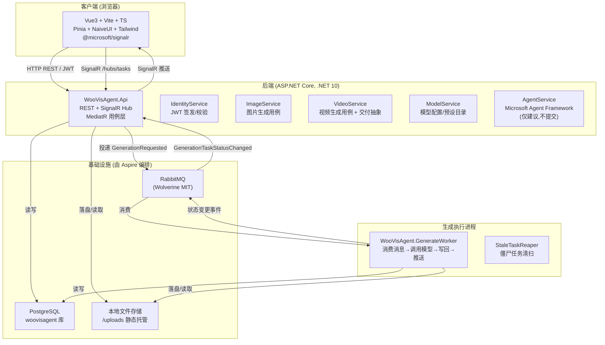
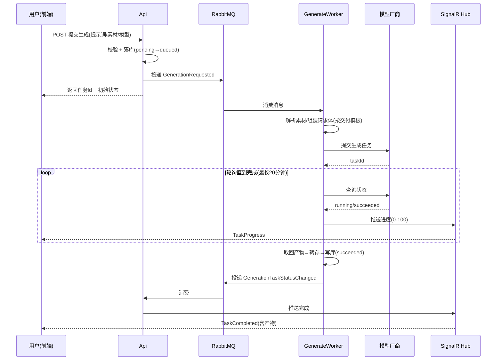
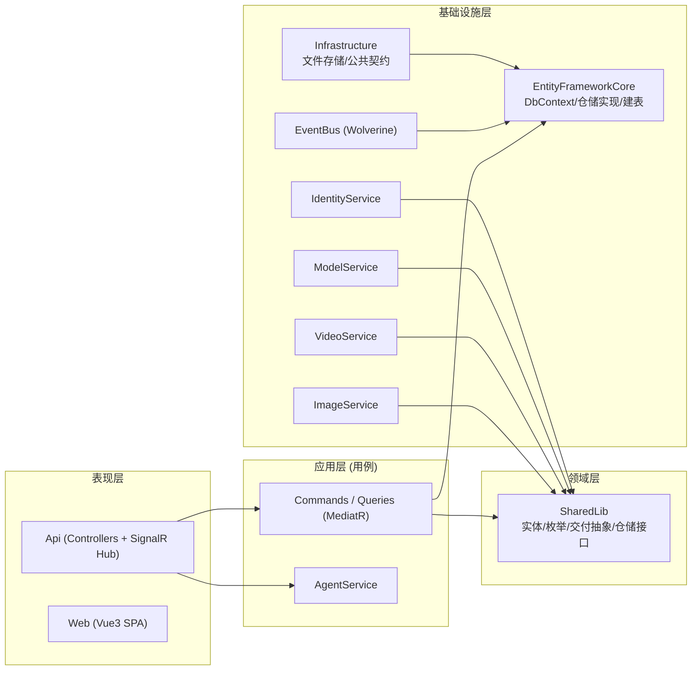
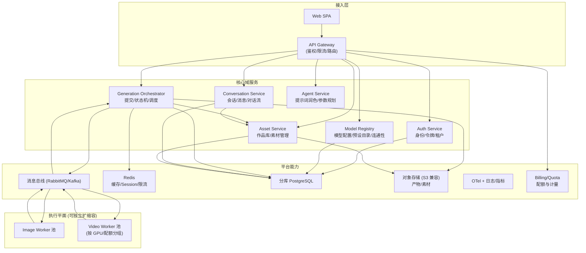

# WooVisAgent 系统架构文档

> 版本：1.0
> 适用读者：架构师、研发、运维
> 配套文档：《PRD.md》（功能需求）、《Project.md》（项目结构速查）

---

## 1. 系统架构总览

本系统是一个**自托管、模型无关**的 AI 图片/视频创作平台。其核心设计思想是：**把"调用具体厂商模型"这件事彻底配置化、数据化**，业务代码只认"预设 + 交付模板 + 能力声明"这套统一抽象，从而做到"接任何厂商只改模型配置、不改代码"。

系统采用经典的前后端分离 + **异步生成**架构：

- 前端（Vue3 SPA）通过 HTTP + SignalR 与后端通信。
- 后端采用 .NET 10 + MediatR（CQRS 风格）+ EF Core，以 .NET Aspire 统一编排。
- 生成类任务走"**提交落库 → 投递消息到 RabbitMQ → GenerateWorker 消费执行 → SignalR 推回前端**"的异步链路，图片与视频共用同一套结构。

### 1.1 逻辑架构图



### 1.2 一次生成的端到端时序



---

## 2. 技术栈总览

| 层 | 技术 | 选型理由 |
| --- | --- | --- |
| 前端框架 | Vue 3.5 + TypeScript + Vite 8 | 轻量、组合式 API、构建快 |
| 前端状态 | Pinia 4 | 轻量全局状态，替代 Vuex |
| UI 组件 | Naive UI 2.45 | 开箱即用、TypeScript 友好、主题可控 |
| 样式 | Tailwind CSS 4 | 原子化、与 Naive 主题共存 |
| 路由 | vue-router 5 | 前端路由 |
| 实时通信 | @microsoft/signalr 10 | 与 .NET SignalR 原生对齐 |
| HTTP 客户端 | axios 1 | 请求/拦截统一封装 |
| 后端框架 | ASP.NET Core (.NET 10) | 跨平台、高性能、云原生 |
| 应用编排 | .NET Aspire | 本地多项目编排、服务发现、OTel 一站式 |
| CQRS | MediatR | 用例(Command/Query)与控制器解耦 |
| ORM | EF Core | 领域建模 + 仓储 |
| 消息总线 | Wolverine (MIT) + RabbitMQ | 替代商用授权的 MassTransit 9，零许可成本 |
| 实时推送 | ASP.NET Core SignalR | 进度/状态 WebSocket 推送 |
| 数据库 | PostgreSQL | 关系型，JSONB 存交付模板/参数 |
| 文件存储 | 本地文件系统（可替换接口） | 产物与参考素材落盘，`/uploads` 静态托管 |
| 智能体 | Microsoft Agent Framework (`Microsoft.Agents.AI` + `.OpenAI`) | 提示词润色/视频参数规划，仅决策不执行 |
| 认证 | JWT Bearer | 无状态、适配 REST + WebSocket |
| 可观测 | OpenTelemetry（Aspire 面板） | 链路追踪、指标、日志统一 |

---

## 3. 系统分层与项目结构

### 3.1 分层职责



### 3.2 项目清单与职责

| 项目 | 角色 | 关键职责 |
| --- | --- | --- |
| `WooVisAgent.AppHost` | 编排入口 | Aspire 编排：拉起 Postgres、RabbitMQ、Api、Worker、Web，注入连接串与 OTLP |
| `WooVisAgent.Api` | 接口网关 | REST 控制器、SignalR Hub(`/hubs/tasks`)、JWT 校验、文件上传、MediatR 调度 |
| `WooVisAgent.GenerateWorker` | 生成执行者 | 后台宿主，消费 `GenerationRequested`，调用模型，写回结果，推送状态；含 `StaleTaskReaper` |
| `WooVisAgent.SharedLib` | 领域核心 | 实体/枚举、视频模式与交付抽象(`VideoDelivery*`)、`IModelDeliveryProtocol`、雪花 ID、结果包装 |
| `WooVisAgent.EventBus` | 消息总线 | Wolverine + RabbitMQ 注册、队列常量、事件类型、`DefaultExecutionTimeout=30min`、显式路由 |
| `WooVisAgent.EntityFrameworkCore` | 数据层 | DbContext、仓储实现、启动三段式自建/补列、单实例锁(`SingleInstanceGuard`) |
| `WooVisAgent.Infrastructure` | 基础设施 | 文件存储实现(`LocalFileStorageService`)、公共契约/存储默认值 |
| `WooVisAgent.ServiceDefaults` | 公共默认值 | Aspire 默认配置（OTel、HealthChecks、服务发现） |
| `WooVisAgent.Services.Common` | 公共工具 | 跨服务公共类型/契约 |
| `WooVisAgentServices.IdentityService` | 身份 | 注册/登录、JWT 签发与校验、邮箱验证码 |
| `WooVisAgentServices.ModelService` | 模型域 | 模型配置 CRUD、启用/默认、连通性测试、供应方模型目录 |
| `WooVisAgentServices.ImageService` | 图片域 | 图片生成提交/查询/取消/删除/选秀、图片交付协议 |
| `WooVisAgentServices.VideoService` | 视频域 | 视频生成用例、`VideoRequestBuilder`(按模板组装请求体)、三种模式校验、交付框架 |
| `WooVisAgentServices.AgentService` | 智能体 | `WooVisDirector`：提示词润色、视频参数规划（仅建议不提交） |
| `WooVisAgent.Web` | 前端 | Vue3 SPA：`views`(对话/任务/作品/模型/会话/工作台)、`components`、`stores`、`api`、`router` |
| `tests/WooVisAgent.Api.Tests` | 测试 | 交付形状/校验/状态机等用例（190+） |

### 3.3 前端结构

```
WooVisAgent.Web/src
├── api/          # HTTP 封装：auth/image/video/task/conversation/model/agent/file/material
├── components/   # 公共组件：TaskCard、ImagePreview、VideoPlayer、VideoModePicker、ModelSettingForm、layout
├── views/        # 页面：workspace/chat/conversation/task/material/model/auth
├── stores/       # Pinia：appStore/authStore/conversationStore/materialStore/modelStore/taskStore
├── router/       # 路由与侧边栏菜单派生
├── hooks/        # useSignalR（实时通道 + 轮询兜底）
├── utils/        # 时间/文件/媒体格式化
├── types/        # 前后端对齐的类型定义
└── assets/styles/# 主题与样式
```

---

## 4. 关键架构机制

### 4.1 异步生成链路（提交与执行解耦）

- **提交侧（Api）**：只做校验 + 落库（状态 `pending`→`queued`）+ 投递 `GenerationRequested` 到 RabbitMQ，立即返回任务 Id。
- **执行侧（Worker）**：消费消息，按模型交付模板解析素材、组装请求体、调用厂商接口、轮询直到完成、转存产物、写回状态。
- **回推侧（SignalR）**：Worker 把状态变更再投递 `GenerationTaskStatusChanged` 到 Api 队列，Api 的消费者推送给前端。
- **图片与视频共用同一结构**：只是不同的消息类型与用例处理器，便于统一运维与排障。

### 4.2 消息总线（Wolverine + RabbitMQ）

- 选型 **Wolverine(MIT)** 替代 MassTransit 9（商用授权），免去启动期许可校验失败导致进程无法启动。
- **消息执行超时 = 30 分钟**：Wolverine 默认 60 秒，而视频轮询可达 20 分钟，默认值会在 ~22% 把任务掐断进死信队列。该常量改动必须联动四处（视频轮询阈值、僵尸回收阈值、执行超时、前端"最长等待"文案）。
- **显式路由**：消息类型 → 目标队列写在代码里（不走约定路由），避免改名悄悄换队列。
- **队列隔离**：Api 与 Worker 各听一条队列，从结构上杜绝"双重消费"。
- **服务定位放开**：处理器构造函数注入服务，须 `ServiceLocationPolicy = AlwaysAllowed`，否则首次消费即进死信。
- 测试环境通过 `EventBus:Enabled=false` 摘掉总线，避免测试连 broker 卡死。

### 4.3 单实例约束

同一套数据库/队列**只允许一套** Api + Worker 运行。两套并存时：状态变更被两个 Api 进程轮流消费，浏览器连着的那一个收不到"生成完成"，进度条永久卡在最后数值；后者还会抢不到端口导致接口 502。系统通过 PostgreSQL **咨询锁(advisory lock)** `SingleInstanceGuard` 在启动时抢锁，抢不到即报错提示，而非静默多开。

### 4.4 视频交付抽象（厂商无关的核心）

这是"接任何厂商只改配置"的关键。三层数据：

1. **预设 `VideoDeliveryPresets`**（纯数据，内置 6 种）：描述一类接口的提交路径、轮询方法、状态字段路径、产物取回方式、分辨率写法。
2. **交付模板 `VideoDeliveryTemplate`**（用户可覆盖）：只填与预设不同的字段即可，如自定义 `submitPath`、`requestFields`、能力声明。
3. **能力声明 `VideoCapabilitySpec`**：该模型支持哪些模式、参考图/视频/音频上限、首尾帧是否要 adaptive 比例。随模板落库，列表出参返回"解析后"的值，前端据此禁用不适用的模式。

请求体形状由 `BodyShape` 区分：`flat`（扁平字段）与 `contentArray`（火山方舟那种 `content` 数组 + `role` 区分素材）。`UrlInline` 开关区分"嵌套/平铺"两种数组写法——**新增厂商 = 加一条预设，不写协议类**。

### 4.5 鉴权（JWT）

- 注册/登录由 `IdentityService` 完成，签发 JWT。
- Api 用 `JwtBearer` 校验；SignalR 的 WebSocket 握手无请求头，约定通过 `access_token` 查询参数传令牌。
- 所有用户资源按 `OwnerId` 隔离。

### 4.6 实时推送 + 轮询兜底

- 正常路径：SignalR 推送 `TaskCreated/TaskStatusChanged/TaskProgress/TaskCompleted/TaskFailed`。
- 兜底路径：聊天页与任务列表都保留轮询（批量查状态接口）。**收到推送只记录 `lastPushAt` 时间戳，不停止轮询**——因为推送可能丢，一旦停轮询漏一条就永久卡住。

### 4.7 数据持久化

- 不走 EF Migration，启动时 `InitializeDatabaseAsync` 三段式自建/补列。
- 给必填列加字段时**必须在配置里设 `HasDefaultValue`**：C# 属性初始值不进 EF 元数据，否则存量行直接 23502，服务起不来。
- 数据库名 `woovisagent`，表名 snake_case、列名 PascalCase。

### 4.8 鲁棒性补充

- **僵尸任务清扫 `StaleTaskReaper`**：把"停在 running 却不再动"的任务收敛为失败，避免执行体崩溃后任务永远转圈。
- **素材逐个解析 + 边界保护**：首尾帧不足 2 张抛友好错误；解析文件名失败 try-catch 返回占位名，避免 500。
- **Agent 失败降级**：带工具的首次失败会自动去掉工具重试一次，兼容不支持 function calling 的中转网关。

---

## 5. 关键技术知识点（速查）

| 主题 | 要点 |
| --- | --- |
| **.NET Aspire** | AppHost 用 `AddPostgres/AddRabbitMQ/AddProject/AddViteApp` 编排；端口交由框架随机分配（避免与企业/其他容器抢端口导致"连错实例"的玄学故障）；`WithOtlpExporter` 是面板有链路数据的必要条件 |
| **MediatR / CQRS** | 控制器只管 HTTP 与鉴权，业务逻辑下沉到 Command/Query Handler；图片/视频/任务复用同一组通用查询用例（按 `type` 过滤） |
| **EF Core** | 仓储模式 + 启动建表；雪花 ID 作主键；JSON 列存模板/参数 |
| **Wolverine** | RabbitMQ 上的轻量消息总线；`DefaultExecutionTimeout`、`ServiceLocationPolicy`、`UseRuntimeCompilation` 是三个易踩点 |
| **SignalR** | Hub 推送 + WebSocket；鉴权走 `access_token` 查询参数；与轮询并存 |
| **Microsoft Agent Framework** | `ChatClientAgent` + `IChatClient` 抽象；工具调用用 `AIFunctionFactory`；解析模型输出按 key 逐字段取，兼容不合规 JSON |
| **Vue3 组合式** | `setup` + `<script setup>`；`storeToRefs` 解构保持响应性（直接 `const x = store.x` 会退化为快照，导致筛选失效） |
| **Pinia** | 按领域拆分 store；状态变更集中、便于轮询兜底 |
| **Tailwind + NaiveUI** | 原子类布局 + 组件库主题共存；暗/亮主题通过 Naive 主题变量切换 |
| **单实例/分布式锁** | PostgreSQL advisory lock 实现进程级互斥，保障消息消费不被分流 |

---

## 6. 未来微服务架构设计思想与拆分思路

当前单体编排（Api + Worker + 共享库）适合个人/小团队自托管。当面临**多租户、计费、高并发、厂商调度、团队规模化**时，应按"领域边界 + 资源特征"拆分为微服务。下面给出设计思想与参考拆分，不绑定具体落地版本。

### 6.1 为什么拆（驱动力）

| 驱动力 | 说明 |
| --- | --- |
| 资源不对等 | 视频生成耗时数分钟、吃 GPU/外部配额；图片秒级。混在一个 Worker 会互相阻塞 |
| 弹性差异 | 生成执行器需要按队列深度独立扩缩容，Web/Api 不需要 |
| 故障隔离 | 某个厂商网关抖动不应拖垮账号/模型配置等基础服务 |
| 团队边界 | 模型接入、生成编排、对话/作品可独立演进 |
| 多租户/计费 | 需独立的账户、配额、计量服务 |

### 6.2 拆分后的目标拓扑



### 6.3 拆分原则

1. **按领域边界拆，而非按技术层拆**：每个微服务拥有自己的领域模型与数据库（数据库per-service），避免共享库导致的"隐式耦合"。当前 `SharedLib` 的实体应下沉为各服务的内部模型或契约(Contracts)。
2. **按资源特征拆执行器**：`Image Worker` 与 `Video Worker` 独立池，视频 Worker 可按 GPU/厂商配额进一步分组，实现差异化的扩缩容与限流。
3. **编排与执行分离**：`Generation Orchestrator` 只管状态机、调度、重试、超时、计费钩子；真正的模型调用在 Worker。这与当前"Api 提交 + Worker 执行"一致，只是把 Api 里的编排职责独立成服务。
4. **同步 + 异步双通道**：服务间同步调用走 gRPC/HTTP（低延迟、强一致）；跨服务的长任务走消息总线（解耦、削峰、可重放）。
5. **契约优先**：前后端、服务间用显式 Contracts（如 Protobuf/OpenAPI），避免"改一处牵全身"。当前 `DeliveryJson`/`VideoDeliveryTemplate` 这类数据化抽象正是良好契约的起点。
6. **平台能力下沉**：鉴权(JWT)、缓存(Redis)、对象存储、可观测、配额计量与业务服务解耦，作为横向平台提供。

### 6.4 数据拆分与一致性

- **分库**：用户/账号、模型配置、任务、会话、作品各自独立库（或 schema），服务只读写自己的库。
- **跨服务数据**：通过**事件驱动 + 最终一致**同步。例如"任务完成"事件被 `Asset Service` 消费以更新作品索引；"选秀"由 Orchestrator 发命令、Asset 落地。
- **Saga/编排式事务**：跨服务的长流程（提交→生成→选秀→计费）用 Saga 管理补偿（生成失败则回滚配额）。
- **对象存储替代本地盘**：产物与素材迁到 S3 兼容存储，天然支持多实例共享、CDN 加速与 24h 过期转存（解决当前百炼地址过期问题）。

### 6.5 通信与治理

| 关注点 | 方案 |
| --- | --- |
| 服务发现 | 容器编排(K8s) Service / Aspire 演进为 K8s |
| 网关 | API Gateway 统一鉴权、限流、灰度、路由 |
| 异步 | 消息总线支持死信、重试、延迟队列（替代当前 Wolverine 超时手工联动） |
| 配置 | 配置中心；模型预设继续走"数据化"思路，可放到 Model Registry 动态下发 |
| 可观测 | 统一 OTel；每个服务暴露健康与指标；分布式追踪串联生成链路 |
| 多租户 | Auth Service 承载租户上下文；配额/计量服务按租户限流与计费 |

### 6.6 演进路线（建议）

1. **阶段一（当下）**：保持当前 Aspire 单体编排，夯实"交付抽象 + 单实例约束 + 实时兜底"，先让多厂商接入零代码化稳定。
2. **阶段二（纵向拆分）**：把 `GenerateWorker` 拆为 Image/Video 两个独立部署单元，分别扩缩容；引入 Redis 缓存热点（模型配置、会话）。
3. **阶段三（服务化）**：将 Auth、Model Registry、Conversation、Asset 独立为服务，Api 退化为 Gateway/BFF；引入消息总线事件驱动同步。
4. **阶段四（平台化）**：配额/计费、对象存储、多租户；K8s 编排；按厂商/GPU 分组调度视频 Worker；灰度与蓝绿发布。

> 演进期间，**"预设 + 交付模板 + 能力声明"这套厂商无关抽象应作为跨阶段的稳定内核**保留并强化——它是系统从"接一家写一套"走向"配置即接入"的根本。

---

## 7. 风险与约束备忘

- **单实例约束是硬约束**：微服务化前，务必确保生产环境只有一套 Api + Worker 运行，否则进度推送会被分流、状态永久卡死。
- **超时常量联动**：任何视频轮询/执行超时相关常量改动，必须同步检查视频轮询阈值、僵尸回收阈值、执行超时、前端文案四处。
- **厂商差异数据化**：新增厂商优先加预设（纯数据）或交付模板，避免新增协议类；厂商文档写死的 `role`、分辨率大小写、比例约束必须由系统强制。
- **不静默失败**：所有写操作/外部调用失败须有明确错误，避免"任务一直转圈"这类难查故障。
- **本地盘短板**：当前产物存本地盘，多实例/容器迁移会丢共享；微服务化阶段应尽早迁对象存储。
